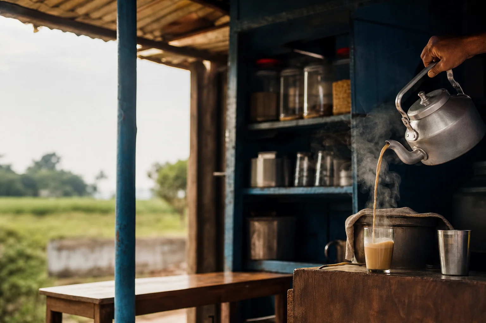

<link rel="stylesheet" href="https://fonts.googleapis.com/css2?family=Bricolage+Grotesque:opsz,wght@12..96,500;12..96,700;12..96,800&display=swap">

<section class="relative isolate overflow-hidden bg-zinc-950">
  
  

  

    

      

        Tea stall
      

      <h1 class="mt-5 font-['Bricolage_Grotesque'] text-[clamp(3rem,10vw,6.5rem)] font-extrabold leading-[0.92] tracking-tight text-white">
        Welcome to
        {{ page.title }}
      </h1>
      
Masala chai and snacks, poured hot from the kettle at a small corner stall.

    

    

      <a href="#menu" class="inline-flex min-h-12 items-center gap-2 rounded-full bg-brand px-7 py-3 text-base font-semibold text-white shadow-lg shadow-brand/40 transition hover:-translate-y-0.5 hover:bg-teal-600 focus-visible:outline-2 focus-visible:outline-offset-2 focus-visible:outline-teal-300">
        View menu
        <svg class="h-4 w-4" viewBox="0 0 24 24" fill="none" stroke="currentColor" stroke-width="2" stroke-linecap="round" stroke-linejoin="round" aria-hidden="true"><path d="M5 12h14M13 6l6 6-6 6"/></svg>
      </a>
      <a href="#visit" class="inline-flex min-h-12 items-center rounded-full bg-white/10 px-7 py-3 text-base font-semibold text-white ring-1 ring-white/30 backdrop-blur transition hover:-translate-y-0.5 hover:bg-white/20 focus-visible:outline-2 focus-visible:outline-offset-2 focus-visible:outline-white">Find the stall</a>
    

    {{# if site.contact.hours }}
    

      <svg class="h-5 w-5 text-teal-300" viewBox="0 0 24 24" fill="none" stroke="currentColor" stroke-width="1.75" stroke-linecap="round" stroke-linejoin="round" aria-hidden="true"><circle cx="12" cy="12" r="9"/><path d="M12 7v5l3 2"/></svg>
      Open {{ site.contact.hours }}
    

    {{/ if }}
  

</section>

<section id="about" class="relative scroll-mt-20 overflow-hidden bg-linear-to-b from-teal-50/70 via-white to-white">
  

  

    

      

        <h2 class="font-['Bricolage_Grotesque'] text-3xl font-bold tracking-tight text-zinc-950 sm:text-4xl">Our story</h2>
        

          <svg class="h-5 w-5" viewBox="0 0 24 24" fill="none" stroke="currentColor" stroke-width="1.75" stroke-linecap="round" stroke-linejoin="round" aria-hidden="true"><rect x="3" y="5" width="18" height="16" rx="2"/><path d="M8 3v4M16 3v4M3 11h18"/></svg>
          Since 2020
        

      

      

        
Chai Corner is a fictional tea stall. We have served masala chai since 2020. It is still the cup we pour first.

      

    

  

</section>

<section id="menu" class="relative scroll-mt-20 overflow-hidden bg-white">
  

  

    

      

        <h2 class="font-['Bricolage_Grotesque'] text-4xl font-bold tracking-tight text-zinc-950 sm:text-5xl">Three drinks, made to order</h2>
        
A short menu, poured fresh for every cup. Hot, spiced or cold and sharp.

      

      

        <article class="group relative overflow-hidden rounded-3xl bg-brand p-8 text-white shadow-xl shadow-brand/25 transition hover:-translate-y-1 hover:shadow-2xl hover:shadow-brand/30 md:row-span-2 md:flex md:flex-col md:justify-between">
          

          

            

            <svg class="mt-1 h-14 w-14 text-teal-100" viewBox="0 0 48 48" fill="none" stroke="currentColor" stroke-width="2" stroke-linecap="round" stroke-linejoin="round" aria-hidden="true"><path d="M8 18h26v10a12 12 0 0 1-12 12h-2A12 12 0 0 1 8 28V18Z"/><path d="M34 21h3a5 5 0 0 1 0 10h-3"/></svg>
            
The house cup

          

          

            

              <h3 class="font-['Bricolage_Grotesque'] text-3xl font-bold sm:text-4xl">Masala Chai</h3>
              
$3

            

            
Spiced milk tea

          

        </article>

        <article class="group rounded-3xl bg-white p-7 ring-1 ring-zinc-200 shadow-sm transition hover:-translate-y-1 hover:shadow-lg hover:ring-brand/40">
          

            
              <svg class="h-6 w-6" viewBox="0 0 24 24" fill="none" stroke="currentColor" stroke-width="1.75" stroke-linecap="round" stroke-linejoin="round" aria-hidden="true"><path d="M7 14c-2-3 0-7 3-8 1 2 4 2 5 0 3 1 4 5 2 8-1.5 2.5-4 4-5 4s-3.5-1.5-5-4Z"/><path d="M12 10v8"/></svg>
            
            
$3

          

          <h3 class="mt-6 font-['Bricolage_Grotesque'] text-2xl font-bold text-zinc-950">Ginger Tea</h3>
          
Fresh ginger and tea

        </article>

        <article class="group rounded-3xl bg-linear-to-br from-teal-50 to-white p-7 ring-1 ring-teal-100 shadow-sm transition hover:-translate-y-1 hover:shadow-lg hover:ring-brand/40">
          

            
              <svg class="h-6 w-6" viewBox="0 0 24 24" fill="none" stroke="currentColor" stroke-width="1.75" stroke-linecap="round" stroke-linejoin="round" aria-hidden="true"><path d="M6 4h12l-1.5 16h-9L6 4Z"/><path d="M6.5 9h11"/><circle cx="15" cy="4" r="2.5"/></svg>
            
            
$4

          

          <h3 class="mt-6 font-['Bricolage_Grotesque'] text-2xl font-bold text-zinc-950">Iced Lemon Tea</h3>
          
Cold and sharp

        </article>
      

    

    

      <h3 class="font-['Bricolage_Grotesque'] text-xl font-bold text-zinc-950">Something to go with it</h3>
      

        

          
          Vegetable samosa
        

        

          
          Butter biscuits
        

        

          
          Onion pakora
        

      

    

  

</section>

<section id="stall" class="scroll-mt-20 bg-zinc-950 text-white">
  

    

      

      

        
      

    

    

      <h2 class="font-['Bricolage_Grotesque'] text-4xl font-bold tracking-tight sm:text-5xl">A small stall on the corner</h2>
      
Chai Corner is a small tea stall. We keep the kettle on, pour masala chai the way it should be, spiced and milky, and keep a few snacks by the counter.

      
Pull up a seat on the bench, or take your cup with you.

      <a href="#visit" class="mt-8 inline-flex min-h-12 items-center gap-2 text-base font-semibold text-teal-300 underline-offset-4 transition hover:text-teal-200 hover:underline focus-visible:outline-2 focus-visible:outline-offset-4 focus-visible:outline-teal-300">
        When to find us
        <svg class="h-4 w-4" viewBox="0 0 24 24" fill="none" stroke="currentColor" stroke-width="2" stroke-linecap="round" stroke-linejoin="round" aria-hidden="true"><path d="M5 12h14M13 6l6 6-6 6"/></svg>
      </a>
    

  

</section>

<section id="visit" class="scroll-mt-20 bg-teal-50/60">
  

    

      <h2 class="font-['Bricolage_Grotesque'] text-4xl font-bold tracking-tight text-zinc-950 sm:text-5xl">Visit the stall</h2>
      
Walk up, order at the counter and we'll pour it fresh.

    

    

      {{# if site.contact.hours }}
      

        <svg class="h-7 w-7 text-brand" viewBox="0 0 24 24" fill="none" stroke="currentColor" stroke-width="1.75" stroke-linecap="round" stroke-linejoin="round" aria-hidden="true"><circle cx="12" cy="12" r="9"/><path d="M12 7v5l3 2"/></svg>
        <h3 class="mt-5 text-sm font-semibold uppercase tracking-[0.16em] text-zinc-500">Opening hours</h3>
        
{{ site.contact.hours }}

      

      {{/ if }}
      {{# if site.contact.address }}
      

        <svg class="h-7 w-7 text-brand" viewBox="0 0 24 24" fill="none" stroke="currentColor" stroke-width="1.75" stroke-linecap="round" stroke-linejoin="round" aria-hidden="true"><path d="M12 21s-7-6.5-7-12a7 7 0 0 1 14 0c0 5.5-7 12-7 12Z"/><circle cx="12" cy="9" r="2.5"/></svg>
        <h3 class="mt-5 text-sm font-semibold uppercase tracking-[0.16em] text-zinc-500">Where</h3>
        
{{ site.contact.address }}

      

      {{/ if }}
      {{# if site.contact.email }}
      <a href="mailto:{{ site.contact.email }}" class="group rounded-3xl bg-white p-7 shadow-sm ring-1 ring-teal-100 transition hover:-translate-y-1 hover:shadow-lg hover:ring-brand/40 focus-visible:outline-2 focus-visible:outline-offset-2 focus-visible:outline-brand">
        <svg class="h-7 w-7 text-brand" viewBox="0 0 24 24" fill="none" stroke="currentColor" stroke-width="1.75" stroke-linecap="round" stroke-linejoin="round" aria-hidden="true"><rect x="3" y="5" width="18" height="14" rx="2"/><path d="m4 7 8 6 8-6"/></svg>
        <h3 class="mt-5 text-sm font-semibold uppercase tracking-[0.16em] text-zinc-500">Email</h3>
        
{{ site.contact.email }}

      </a>
      {{/ if }}
      {{# if site.contact.phone }}
      <a href="tel:{{ site.contact.phone }}" class="group rounded-3xl bg-white p-7 shadow-sm ring-1 ring-teal-100 transition hover:-translate-y-1 hover:shadow-lg hover:ring-brand/40 focus-visible:outline-2 focus-visible:outline-offset-2 focus-visible:outline-brand">
        <svg class="h-7 w-7 text-brand" viewBox="0 0 24 24" fill="none" stroke="currentColor" stroke-width="1.75" stroke-linecap="round" stroke-linejoin="round" aria-hidden="true"><path d="M5 4h4l2 5-2.5 1.5a11 11 0 0 0 5 5L15 13l5 2v4a2 2 0 0 1-2 2A16 16 0 0 1 3 6a2 2 0 0 1 2-2Z"/></svg>
        <h3 class="mt-5 text-sm font-semibold uppercase tracking-[0.16em] text-zinc-500">Phone</h3>
        
{{ site.contact.phone }}

      </a>
      {{/ if }}
    

  

</section>

<section class="relative overflow-hidden bg-brand">
  

  

  

    

      <h2 class="font-['Bricolage_Grotesque'] text-4xl font-bold tracking-tight text-white sm:text-5xl">The kettle's on</h2>
      
Come by for a cup of masala chai.

    

    

      {{# if site.contact.email }}
      <a href="mailto:{{ site.contact.email }}" class="inline-flex min-h-12 items-center rounded-full bg-white px-7 py-3 text-base font-semibold text-brand shadow-lg shadow-zinc-950/20 transition hover:-translate-y-0.5 hover:bg-teal-50 focus-visible:outline-2 focus-visible:outline-offset-2 focus-visible:outline-white">Get in touch</a>
      {{/ if }}
      <a href="#menu" class="inline-flex min-h-12 items-center rounded-full px-7 py-3 text-base font-semibold text-white ring-1 ring-white/50 transition hover:-translate-y-0.5 hover:bg-white/10 focus-visible:outline-2 focus-visible:outline-offset-2 focus-visible:outline-white">Back to the menu</a>
    

  

</section>

